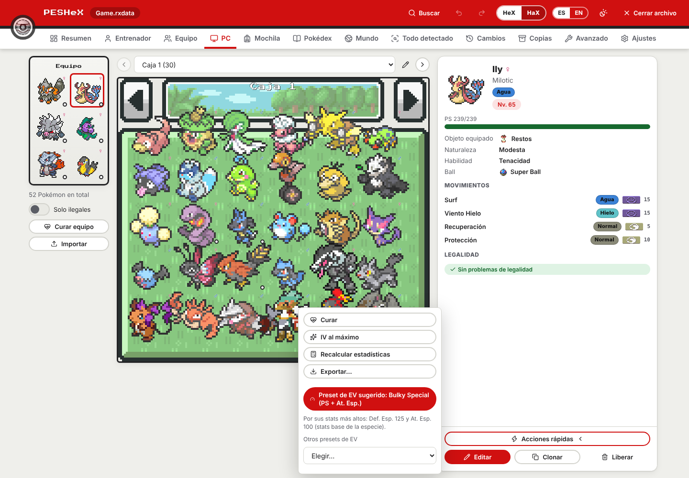
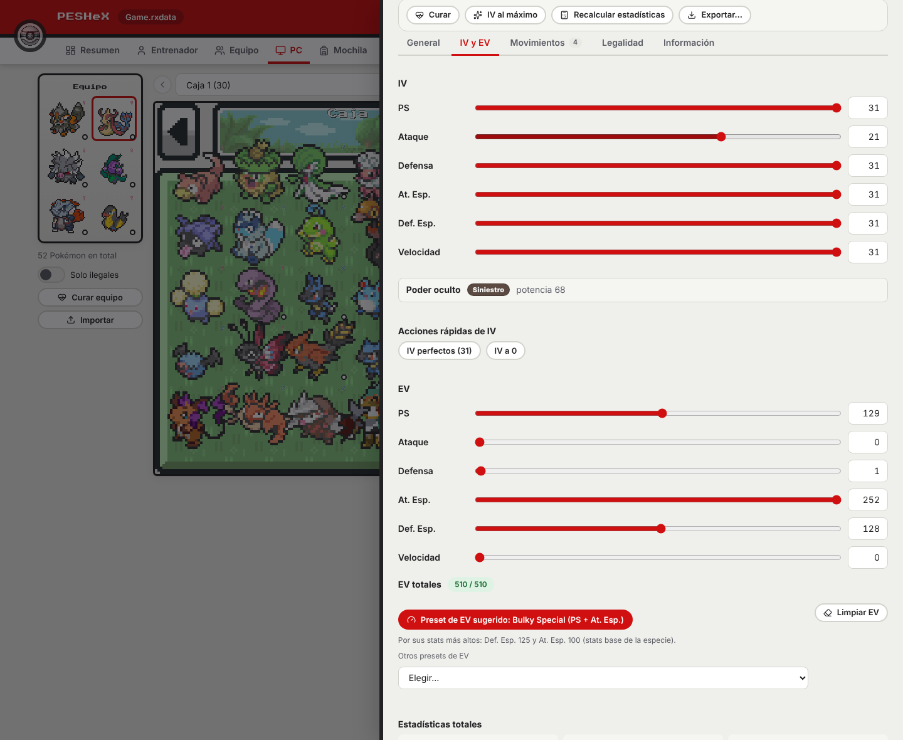
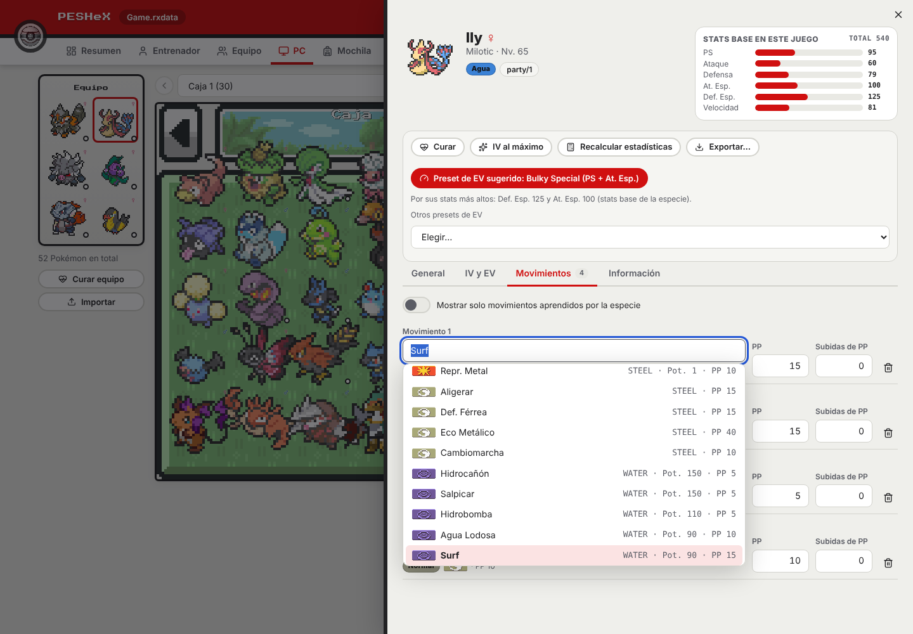
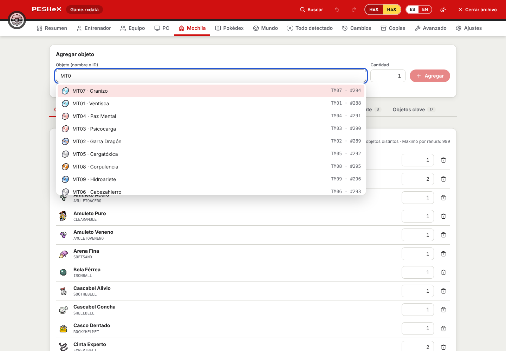
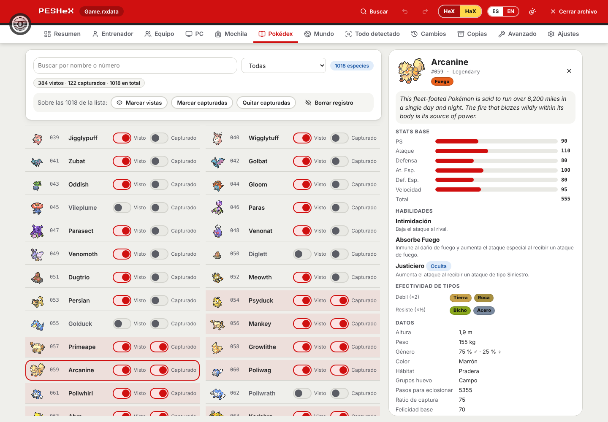

<p align="center"></p>

# PESHeX — Pokémon Essential HeX

Editor **visual** de partidas guardadas (`.rxdata`) de **Pokémon Essentials** y
fangames basados en él. Detecta automáticamente qué base de Essentials usa la
partida (v16–v21 y bases personalizadas como *La Base de Sky*) y muestra el
entrenador, el equipo, el PC, la mochila, los IV/EV, los movimientos… en
pestañas sencillas, en **español** e **inglés**, con una interfaz inspirada en
una Poké Ball.

> Herramienta de fans, sin afiliación con Nintendo, Game Freak ni The Pokémon
> Company. Pokémon y Poké Ball son marcas de sus respectivos propietarios.

## Descargar y usar (Windows)

1. Entra en [Releases](https://github.com/zeik-dev/pbs-editor/releases) y baja
   **`PESHeX-<versión>-windows-x64.zip`** (junto a `SHA256SUMS.txt`).
2. Extrae **todo** el contenido en una carpeta y abre `PESHeX.exe`. No hay que
   instalar nada: Ruby viene incluido (`ruby/`) y el motor de edición también
   (`rxdata/`).
3. Abre tu partida (`Game.rxdata`; en Essentials v19+ suele estar en
   `%APPDATA%\<NombreDelJuego>\`) y, en **Ajustes**, vincula la carpeta de tu
   juego para ver los nombres y los gráficos reales y para que HeX compruebe la
   legalidad con *tus* reglas.

Requiere Windows 10/11 de 64 bits y Microsoft Edge WebView2 (viene con Windows 11
y con Windows 10 actualizado; si falta, PESHeX lo avisa y da el enlace).

> **Windows SmartScreen / antivirus.** El ejecutable **no está firmado** (la
> firma de código es de pago), así que Windows puede mostrar «Windows protegió
> tu PC» la primera vez (*Más información → Ejecutar de todas formas*) y algún
> antivirus puede dar un falso positivo. Comprueba el zip con `SHA256SUMS.txt`
> (`Get-FileHash`). `LEEME.txt`, dentro del zip, lo explica paso a paso.

## Qué hace

PESHeX reparte la partida en pestañas (*Resumen, Entrenador, Equipo, PC, Mochila,
Pokédex, Mundo, Todo detectado, Cambios, Copias, Avanzado y Ajustes*). No hay
títulos de página: la pestaña activa ya dice dónde estás. Estas son las funciones
principales; la tabla del final resume el resto.

### Equipo y PC como en los juegos

<p align="center">
  
</p>

- Equipo y caja de 6×5 con el fondo y los iconos de *tu* juego, a todo el alto de la
  ventana. El panel de datos es compacto y **lo único que hace scroll**.
- Arrastra (o usa la barra espaciadora) para mover, intercambiar o pasar Pokémon entre
  cajas y equipo.
- **Clic derecho**: en un Pokémon, *Editar · Clonar · Exportar · Eliminar*; en una casilla
  vacía, **Agregar Pokémon** por especie (con búsqueda por nombre y número).
- El panel lleva *Editar · Clonar · Liberar* y un único botón **Acciones rápidas** que
  despliega, hacia la izquierda, curar, IV al máximo, recalcular, exportar y siete presets
  de EV (físico, especial, Bulky Physical, Bulky Special, Tank Defense, Tank Sp. Defense),
  con el sugerido según los stats más altos del Pokémon.
- Debajo del equipo: el total de Pokémon y, en HeX, el filtro *Solo ilegales*.

### Editar un Pokémon

<p align="center">
  
</p>
<p align="center">
  
</p>

La hoja de edición ocupa algo más de la mitad de la ventana y se organiza en
**General · IV y EV · Movimientos · Información** (más **Legalidad** en HeX):

- **Stats base** de la especie *en tu juego* junto al sprite, con su total.
- **Nivel, felicidad, PS, IV y EV** con deslizador *y* campo numérico (un gesto = un solo
  «deshacer»); en PS, el campo admite 0 (debilitado). IV y EV siguen el orden
  *IV → Poder oculto → acciones rápidas → EV → presets → estadísticas totales → recalcular*.
- **Naturaleza** (la original no se toca) y **naturaleza por menta** (`nature_for_stats`, en bases v20+).
- **Habilidad** y **movimientos** con interruptores *«Mostrar solo habilidades de la especie»* y
  *«Mostrar solo movimientos aprendidos por la especie»* (activados por defecto y apagables en
  HaX; en HeX el filtro es obligatorio). Con el filtro **apagado** el selector lista **todas** las habilidades y
  movimientos del juego. Los movimientos muestran su tipo, potencia, PP y el **ícono de su categoría**
  (Físico, Especial, Estado), que sale de la carpeta de *tu* juego (`Graphics/Pictures/category.png`); si no lo
  trae, PESHeX usa tres íconos propios.
- **Objeto equipado** con el mismo selector de la mochila (nombre, icono e id) y **bola** usada.
- **Información**: entrenador original, ID personal y **cintas** con su nombre (`ribbons.txt`).

### Mochila

<p align="center">
  
</p>

- **Agregar objeto** está arriba del todo: busca por nombre, icono o id y lo manda a *su*
  bolsillo según el PBS.
- Las MT/MO se nombran con su movimiento (*MT01 · Ventisca*) y el bolsillo 6 se llama
  **Megapiedras**.
- Bolsillos, búsqueda, cantidades y favoritos.

### Pokédex con ficha de especie

<p align="center">
  
</p>

- Vistas y capturadas por especie, filtros y acciones sobre toda la lista. La pestaña
  siempre está visible; si tu base no guarda la Pokédex como esperamos, explica qué buscó.
- Con la carpeta del juego, cada especie abre una **ficha** con los datos de *tu* juego:
  texto de la Pokédex, altura, peso, género, grupos huevo, captura, EV que otorga,
  **stats base**, habilidades, **debilidades y resistencias** por tipo (de `types.txt`),
  cadena evolutiva y formas (Mega con su piedra), movimientos por nivel/MT/tutor/huevo,
  **dónde encontrarla** (`encounters.txt`) y su **numeración regional**. Si algún dato no se puede leer, la ficha
  lo dice (con el motivo y un botón para reintentar) en vez de quedarse cargando.

### Resto de pestañas

| Pestaña | Contenido |
|---|---|
| **Resumen** | Entrenador, dinero, medallas, tiempo de juego, equipo, cifras (PC, Pokédex…), base detectada y cobertura de clasificación; con el modo **HeX** activo, además, una tarjeta de **legalidad desplegable** |
| **Entrenador** | Nombre, dinero, fichas, puntos de combate, hollín, medallas y datos extra de la base |
| **Mundo** | Interruptores y variables (con sus nombres), estadísticas y Salón de la Fama |
| **Todo detectado** | Lista completa de lo que contiene la partida y cómo se clasificó (*clasificado · personalizado · mundo y motor · sin clasificar*). Nada se pierde |
| **Cambios** | Cambios sin guardar, con deshacer/rehacer |
| **Copias** | Las copias `.bak` que se crean al guardar: **comparar** (entrenador, mochila, Pokémon, Pokédex, mundo) con la partida actual o con otro archivo, y **restaurar** |
| **Avanzado** | Todos los campos crudos del archivo (el explorador original), con filtro por ruta/tipo |
| **Ajustes** | Idioma (auto/ES/EN), tema, color de Poké Ball, copia de seguridad, **zoom de la aplicación** (50 %–200 %, por defecto 100 %), carpeta del juego (con **barra de progreso**), modo HaX/HeX y detección de la base |

Además: **búsqueda global y comandos** (`Ctrl+K`), `Ctrl+S` / `Ctrl+Z` / `Ctrl+Y` y
**clonar / importar / exportar** Pokémon (texto de Pokémon Showdown y JSON propio).

<sub>Capturas con una partida y una carpeta de juego **reales** de *Pokémon Z* (un fangame de
Essentials v16–v18), ya vinculada y analizada: los gráficos son los del propio juego del
autor. PESHeX **no incluye ni distribuye** gráficos oficiales; usa los de tu juego. Se
regeneran con `npm run docs:shots` (`PESHEX_DOCS_GAME=synthetic` usa una carpeta sintética
de círculos de colores cuando no hay `test_pbs/`).</sub>

### Modos HaX y HeX

- **HaX** (por defecto) permite cualquier cambio y **no muestra nada de legalidad**
  (ni interruptores, ni insignias, ni pestañas): solo se explica qué es HeX.
- **HeX** se activa a mano (con un aviso previo), muestra la legalidad (insignias
  ✗/!, tarjeta del Resumen, pestaña *Legalidad*, filtro *Solo ilegales*) y no deja
  introducir Pokémon ni valores **ilegales para tu juego**: especie inexistente, movimientos que no
  puede aprender, habilidad no permitida, nivel o experiencia fuera de rango,
  IV/EV imposibles, PP de más, objetos o bolsillos erróneos… Lo que la partida
  ya traía se marca pero no impide editar otras cosas.

**HeX depende de la carpeta del juego**: hay que vincularla antes para que PESHeX
lea qué movimientos puede aprender cada Pokémon, sus habilidades, objetos y
estadísticas y pueda comprobar si algo es legal. Sin ella solo se aplican reglas
básicas (rangos, duplicados, tamaños) y la app lo avisa como «legalidad parcial».
**HeX puede equivocarse en algunos fangames** (bases con *randomizer*, mecánicas o
datos propios): rechazar cambios que sí son válidos u omitir reglas que no puede
comprobar. Si te estorba, vuelve a HaX en cualquier momento.

### Carpeta del juego

Al vincular la carpeta de tu fangame (la que tiene `Game.ini`, `Data` y
`Graphics`), PESHeX lee de ella —**solo lectura**— los nombres de especies,
movimientos, objetos y habilidades (`Data/*.dat`, con `PBS/` como respaldo),
los límites de `Settings` y los nombres de interruptores y variables
(`System.rxdata`), y usa **tus propios gráficos** para los iconos y las cajas.
**PESHeX no incluye ningún sprite ni artwork oficial.** Sin esa carpeta todo
funciona igual, con el ID interno embellecido en lugar del nombre y marcadores
de color en lugar de iconos.

Los `PBS/` se leen en **ambos formatos**: el CSV de Essentials v16–v18 (ids
enteros, descripciones entrecomilladas, `tm.txt`, `[N]` + `InternalName`) y el INI
de v19–v21 (formas, `ribbons.txt`, `regional_dexes.txt`, `encounters.txt`…). En las
bases antiguas el save solo guarda números y PESHeX los traduce a nombres (y de
vuelta al escribir); el nivel, la habilidad, la naturaleza y la bola, que esas
bases no guardan, se derivan con las mismas fórmulas del motor.

Al abrir una partida **sin carpeta de juego asociada**, PESHeX pregunta si quieres
agregarla (*Agregar directorio de juego · Cancelar · «No volver a preguntar para
esta partida»*) y muestra una **barra de progreso** con los pasos reales de la
lectura (especies, movimientos, objetos, habilidades, tipos, MT, límites,
calibración, gráficos…).

- **Seguro:** guardar crea siempre una copia `.bak`, y *editar + deshacer todo*
  devuelve el archivo byte a byte (hay pruebas automáticas que lo comprueban).

## Cómo detecta la base

`driver/semantic/` no depende de nombres de variable: reconoce **qué es cada
cosa por su forma**.

1. *Perfiles* (`essentials_savedata` v19–v21, `essentials_legacy` v16–v18,
   `generic`) puntúan la partida según la forma de la raíz, la versión, las
   clases y el estilo de IDs.
2. *Descubrimiento de roles*: «Pokémon» = objeto con especie + nivel/exp +
   movimientos; «bolsa» = array de bolsillos con pares `[id, cantidad]`
   (`@pockets`, `@bag`…); «PC» = array de cajas con casillas de Pokémon;
   «entrenador» = objeto con `@party` y nombre.
3. Confianza **alta / media / baja**. Si es baja, la partida queda en *solo
   lectura* hasta que confirmes el perfil en Ajustes.
4. Lo que ningún rol reclama se reparte en los *buckets* de cobertura y se ve
   en «Todo detectado».

> Los perfiles v16–v18 están basados en conocimiento del motor y probados con
> **saves sintéticos** (`test/fixtures/make_legacy_save.rb`). Si tienes saves
> reales de otras bases (Reborn, Rejuvenation, Infinite Fusion, v16/v17/v18…),
> compártelos para afinar los perfiles.

## Arquitectura

```
React 19 + TS (src/)  ──invoke──►  Tauri 2 / Rust (src-tauri/)  ──JSON por línea──►  Ruby (driver/)
 i18n, tema, vistas                 driver_call genérico                              edit_rxdata.rb + capa semántica
```

- **`edit_rxdata.rb`** (no se modifica): lector/escritor Marshal con
  roundtrip byte a byte, índice de campos, inferencia de tipos.
- **`driver/`**: protocolo JSON por línea con registro de comandos
  (`driver/commands/`), sesión con índice de campos perezoso y la capa
  semántica `driver/semantic/` (detección, vistas, cobertura, edición con
  journal reversible y validador).
- **`src-tauri/`**: ventana, diálogo de archivos y el comando genérico
  `driver_call`. La sesión con Ruby vive en el crate `src-tauri/crates/rxdriver`
  (sin dependencia de Tauri, así sus tests corren en cualquier Linux con Ruby).
- **`src/`**: `app/` (cabecera Poké Ball, shell), `features/` (una carpeta por
  pestaña), `ui/` (design system), `i18n/` (es/en), `theme/` (tokens CSS),
  `stores/` (zustand), `api/` (llamadas tipadas al driver).

La app empaqueta su propio Ruby portátil en Windows (el usuario final no
necesita instalar Ruby). En Linux/macOS usa el `ruby` del sistema.

## Desarrollo

### Setup (una sola vez)

1. **Windows (para empaquetar):** instala [7-Zip](https://www.7-zip.org/) y corre
   `powershell -ExecutionPolicy Bypass -File scripts/setup-ruby.ps1`; descarga el
   Ruby portátil en `src-tauri/resources/ruby/` (ignorado por git).
2. `npm install`
3. **Linux** (solo para compilar Tauri): dependencias de WebKitGTK, p. ej.
   `libwebkit2gtk-4.1-dev libgtk-3-dev libsoup-3.0-dev librsvg2-dev`.

`build.rs` copia `edit_rxdata.rb` y `driver/**` a `src-tauri/resources/rxdata/`
en cada build y crea `resources/ruby/` si falta.

### Comandos

```bash
npm run tauri dev        # app de escritorio con recarga en caliente
npm run tauri build      # instalador (Windows)
npm run dev              # solo la UI en el navegador (sin backend)

npm run typecheck        # tsc
npm test                 # vitest: i18n, formateadores, contraste, controles
npm run test:ruby        # minitest: protocolo, capa semántica, edición, bases antiguas y juegos reales
cargo test -p rxdriver   # integración Rust<->Ruby (cd src-tauri)
npm run e2e              # Playwright: UI real contra el driver Ruby real
```

**Pruebas con juegos reales.** `test_pbs/` trae el `PBS` de *Pokémon Añil* (Essentials v21) y
los `Data`, `Graphics`, `Fonts` y `PBS` de *Pokémon Z* (v16–v18), junto a sus partidas en
`test_saves/`. `test/real_pbs_test.rb`, `test/real_saves_test.rb` y `e2e/realgame.spec.ts` los
usan (ensamblados en un directorio temporal, sin modificar nada) y **se omiten solos** si
`test_pbs/` no está.

Las pruebas **e2e** levantan Vite y sustituyen el backend de Tauri por un
puente que habla con el driver Ruby real (`e2e/support/bridge.ts`), sobre
copias de `test_saves/` (nunca se modifican). Dejan capturas en
`e2e/screenshots/` (es/en, claro/oscuro). Si tu Chromium no está en la ruta de
Playwright: `PLAYWRIGHT_CHROMIUM_PATH=/ruta/a/chrome npm run e2e`.

### Probar el driver a mano

```bash
ruby driver/rxdata_driver.rb <<'EOF'
{"id":1,"cmd":"open","path":"test_saves/Partida_2.rxdata","autodetect":false}
{"id":2,"cmd":"get_overview"}
{"id":3,"cmd":"apply_ops","ops":[{"op":"set","ref":"trainer","field":"money","value":5000}]}
{"id":4,"cmd":"undo"}
{"id":5,"cmd":"shutdown"}
EOF
```

### Publicar un release

El flujo `.github/workflows/release-windows.yml` compila `PESHeX.exe` en Windows,
pasa los tests con el Ruby portátil que se distribuye, arma el zip
(`scripts/package-release.mjs`, determinista), lo prueba (`scripts/smoke-release.ps1`:
ruta con espacios y `ñ`, `PATH` reducido, hashes, VersionInfo y un arranque real) y
publica el Release con `SHA256SUMS.txt`.

- Un push a `development` cuyo mensaje empiece por `release: X.Y.Z` (la versión debe
  coincidir con `package.json`, `src-tauri/Cargo.toml` y `src-tauri/tauri.conf.json`)
  publica el Release `vX.Y.Z`; un tag `vX.Y.Z` empujado a mano hace lo mismo.
- `[replace-release]` (junto a `release: X.Y.Z`) borra el Release y el tag de esa versión
  si ya existen y los recrea sobre ese commit (útil tras reescribir el historial).
- `[winbuild]` en el mensaje del commit hace un ensayo sin publicar.
- Firma opcional: define los secretos `WINDOWS_CERT_PFX_B64` y `WINDOWS_CERT_PASSWORD`.

## Hoja de ruta

- **Hecho en la 1.0.0:** detección de bases v16–v21, interfaz estilo PC con los
  gráficos del propio juego, carpeta del juego (nombres, límites, calibración),
  modos HeX/HaX, Pokédex, mundo, copias y comparación, búsqueda global, atajos,
  acciones rápidas e importar/exportar Pokémon.
- **Hecho en la 1.1.0:** interfaz sin títulos de página, Equipo/PC a alto completo con
  clic derecho y *Agregar Pokémon*, legalidad solo en HeX, mochila con selector de objetos
  y Megapiedras, hoja de edición ancha con deslizadores, stats base, naturaleza por menta
  y filtros por especie, lector de PBS v16–v21 (CSV e INI), ficha de especie en la
  Pokédex, cintas, y barra de progreso y aviso al abrir una partida sin carpeta de juego.
- **Pendiente / ideas:** firma de código del ejecutable (el flujo ya la admite
  con los secretos `WINDOWS_CERT_PFX_B64` y `WINDOWS_CERT_PASSWORD`), perfiles
  afinados con más saves reales de otras bases (Reborn, Rejuvenation, v16–v18…)
  y un tema alternativo basado en el logo.

## Licencias y recursos

- Logo e ícono de la app: `branding/PESHeX.png` (arte del autor; no cubierto por la licencia MIT, ver `LICENSE`). La Poké Ball del indicador de carga es un SVG propio.
- Fuente de títulos: [Press Start 2P](https://fonts.google.com/specimen/Press+Start+2P) (SIL OFL 1.1, vía `@fontsource`).
- Iconos de interfaz: [Lucide](https://lucide.dev) (ISC).
- No se empaquetan sprites ni artwork oficiales: los gráficos se leen de la
  carpeta del juego del propio usuario.
