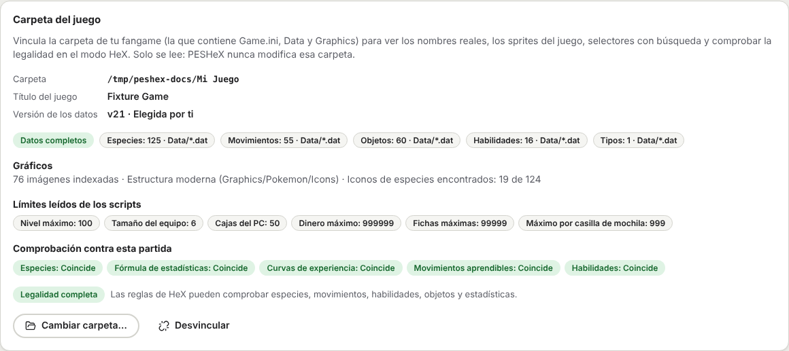
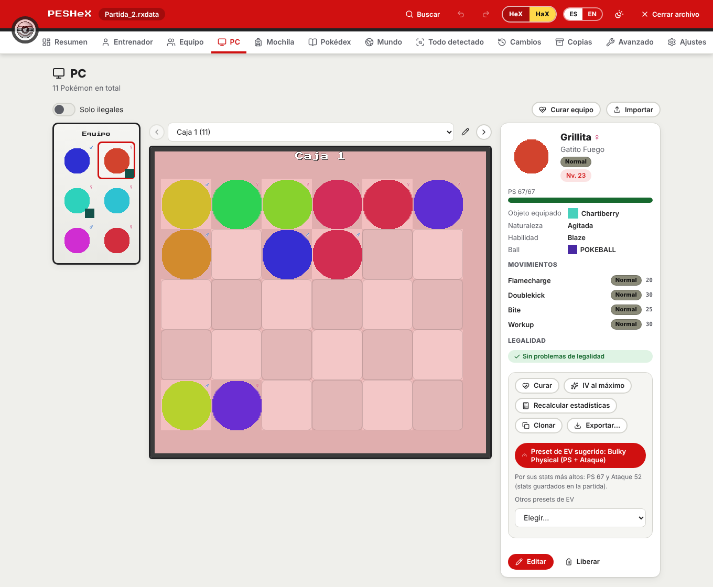
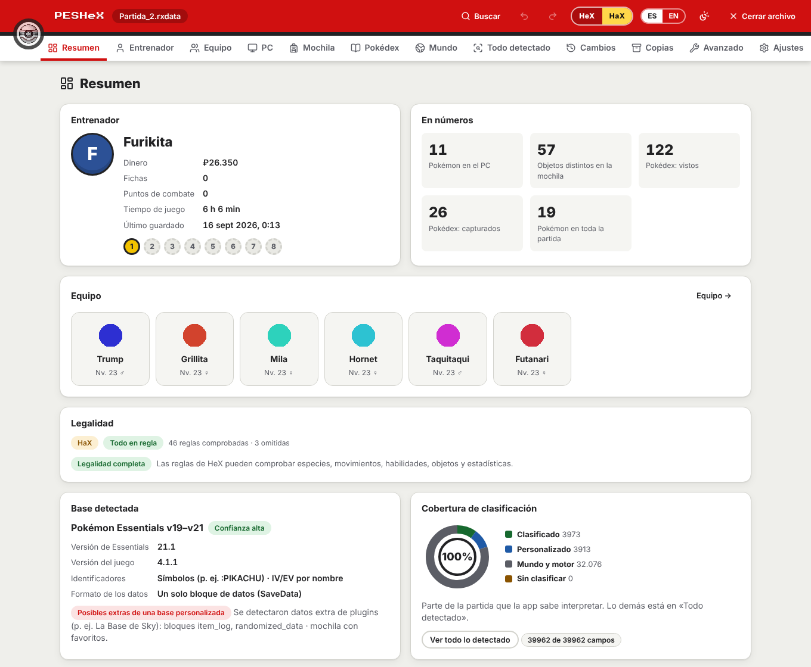
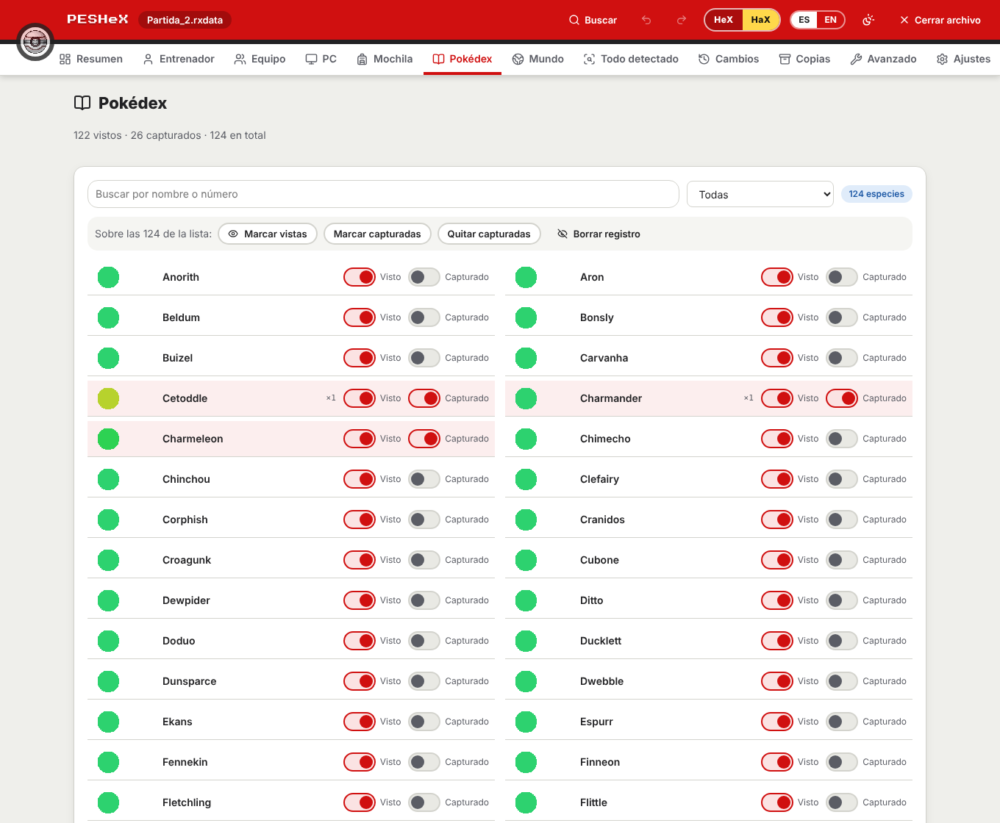
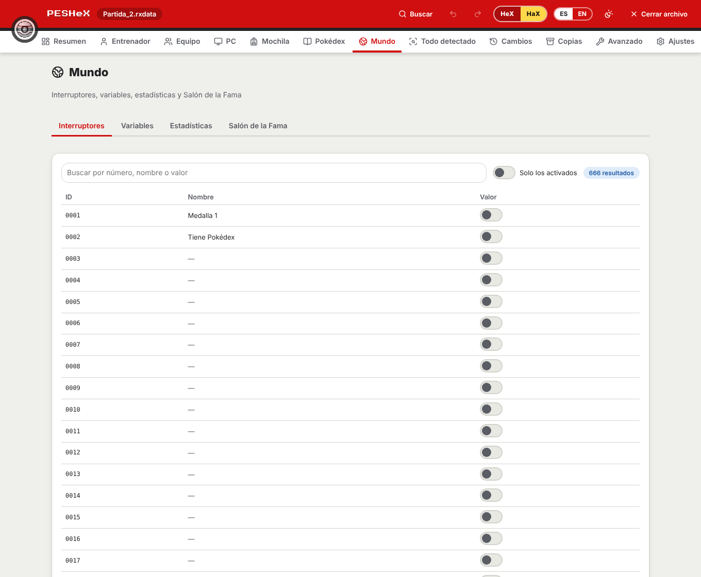
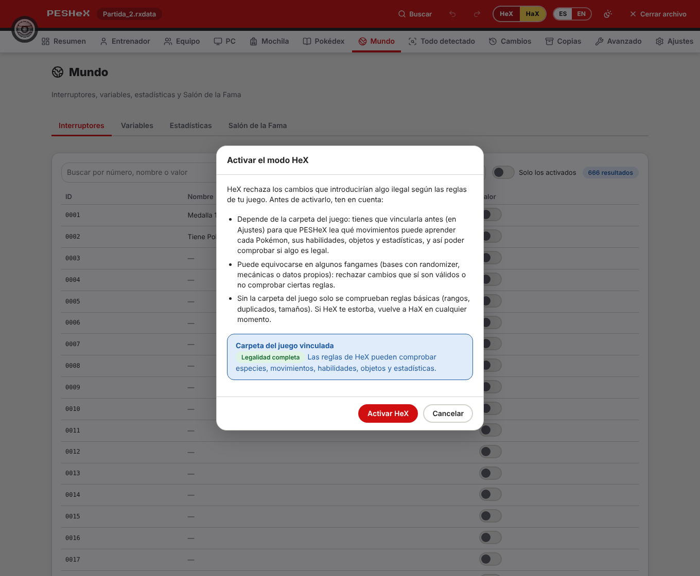
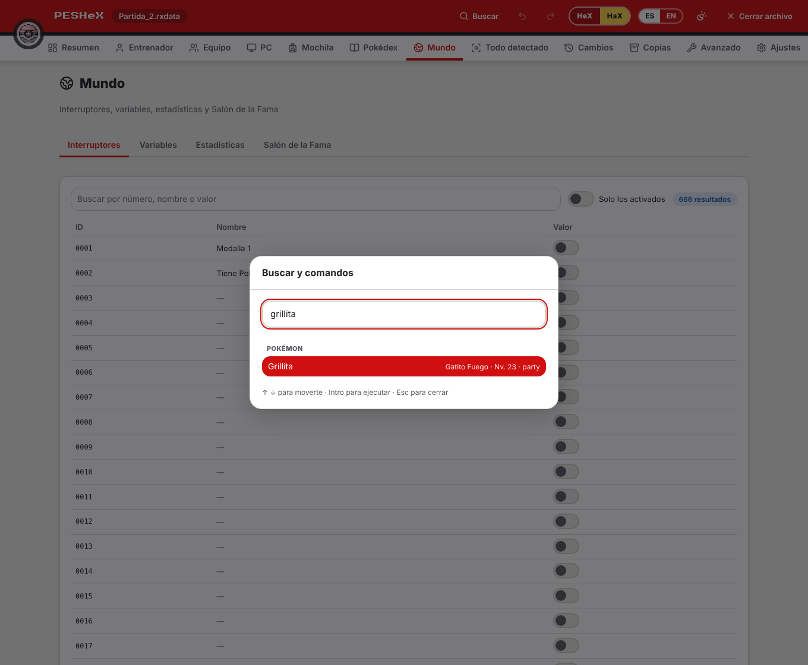
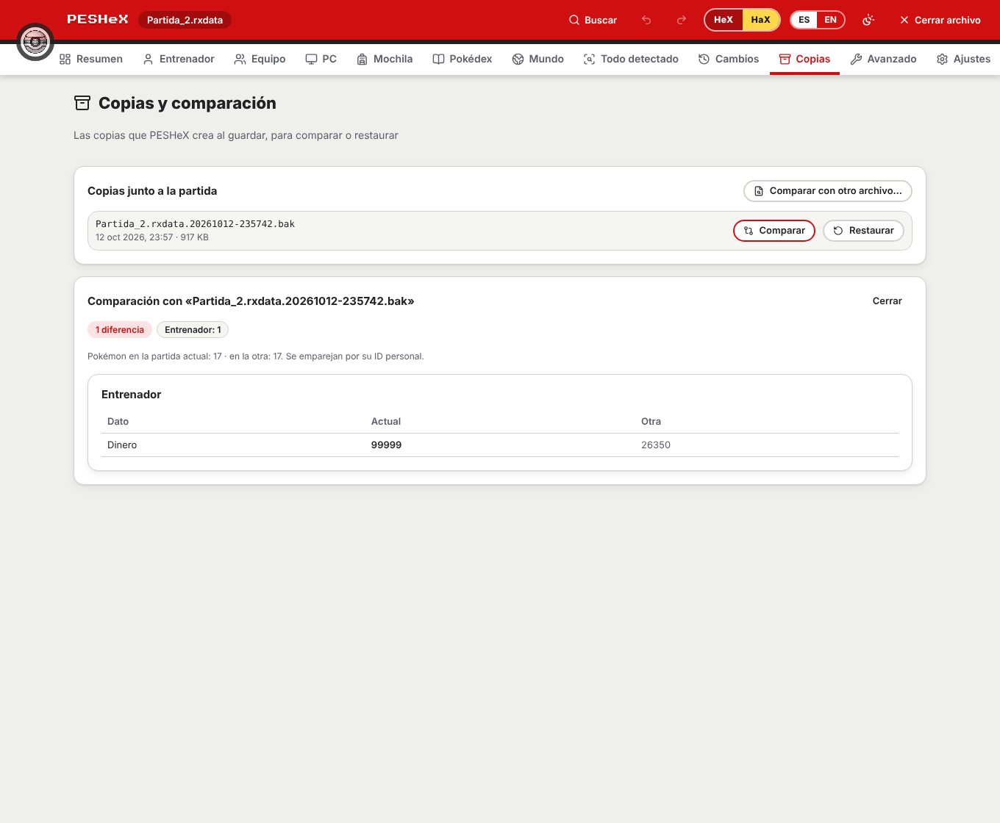

<p align="center"></p>

# PESHeX — Pokémon Essential HeX

Editor **visual** de partidas guardadas (`.rxdata`) de **Pokémon Essentials** y
fangames basados en él. Detecta automáticamente qué base de Essentials usa la
partida (v16–v21 y bases personalizadas como *La Base de Sky*) y muestra el
entrenador, el equipo, el PC, la mochila, los IV/EV, los movimientos… en
pestañas sencillas, en **español** e **inglés**, con una interfaz inspirada en
una Poké Ball.

> Herramienta de fans, sin afiliación con Nintendo, Game Freak ni The Pokémon
> Company. Pokémon y Poké Ball son marcas de sus respectivos propietarios.

## Descargar y usar (Windows)

1. Entra en [Releases](https://github.com/zeik-dev/pbs-editor/releases) y baja
   **`PESHeX-<versión>-windows-x64.zip`** (junto a `SHA256SUMS.txt`).
2. Extrae **todo** el contenido en una carpeta y abre `PESHeX.exe`. No hay que
   instalar nada: Ruby viene incluido (`ruby/`) y el motor de edición también
   (`rxdata/`).
3. Abre tu partida (`Game.rxdata`; en Essentials v19+ suele estar en
   `%APPDATA%\<NombreDelJuego>\`) y, en **Ajustes**, vincula la carpeta de tu
   juego para ver los nombres y los gráficos reales y para que HeX compruebe la
   legalidad con *tus* reglas.

Requiere Windows 10/11 de 64 bits y Microsoft Edge WebView2 (viene con Windows 11
y con Windows 10 actualizado; si falta, PESHeX lo avisa y da el enlace).

> **Windows SmartScreen / antivirus.** El ejecutable **no está firmado** (la
> firma de código es de pago), así que Windows puede mostrar «Windows protegió
> tu PC» la primera vez (*Más información → Ejecutar de todas formas*) y algún
> antivirus puede dar un falso positivo. Comprueba el zip con `SHA256SUMS.txt`
> (`Get-FileHash`). `LEEME.txt`, dentro del zip, lo explica paso a paso.

<p align="center">
  
</p>
<p align="center">
  
  
</p>
<p align="center">
  
  
</p>
<p align="center">
  
  
</p>
<p align="center">
  
</p>

<sub>Capturas con una carpeta de juego **sintética** de pruebas, ya vinculada y analizada
(círculos de colores en lugar de sprites): PESHeX no incluye gráficos oficiales; usa los de tu
juego. Se regeneran con `npm run docs:shots`.</sub>

## Qué hace

| Pestaña | Contenido |
|---|---|
| **Resumen** | Entrenador, dinero, medallas, tiempo de juego, equipo, cifras (PC, Pokédex…), legalidad, base detectada y cobertura de clasificación |
| **Entrenador** | Nombre, dinero, fichas, puntos de combate, hollín, medallas y datos extra de la base |
| **Equipo** y **PC** | Los Pokémon **como en las cajas de los juegos**: caja de 6×5 con el fondo y los iconos de *tu* juego, bandeja de equipo y panel de datos. Arrastra (o usa la barra espaciadora) para mover, intercambiar o pasar Pokémon entre cajas y equipo; editor lateral con **IV/EV**, movimientos, objeto, naturaleza, habilidad… |
| **Mochila** | Bolsillos, búsqueda, cantidades, añadir/quitar objetos, favoritos |
| **Pokédex** | Vistas y capturadas por especie, filtros y acciones sobre toda la lista (siempre visible; si tu base no lo guarda como esperamos, explica qué buscó) |
| **Mundo** | Interruptores y variables (con sus nombres), estadísticas y Salón de la Fama |
| **Todo detectado** | Lista completa de lo que contiene la partida y cómo se clasificó (*clasificado · personalizado · mundo y motor · sin clasificar*). Nada se pierde |
| **Cambios** | Cambios sin guardar, con deshacer/rehacer |
| **Copias** | Las copias `.bak` que se crean al guardar: **comparar** (entrenador, mochila, Pokémon, Pokédex, mundo) con la partida actual o con otro archivo, y **restaurar** |
| **Avanzado** | Todos los campos crudos del archivo (el explorador original), con filtro por ruta/tipo |
| **Ajustes** | Idioma (auto/ES/EN), tema, color de Poké Ball, copia de seguridad, carpeta del juego, modo HeX/HaX y detección de la base |

Además: **búsqueda global y comandos** (`Ctrl+K`), `Ctrl+S` / `Ctrl+Z` / `Ctrl+Y`,
**acciones rápidas** (curar, IV al máximo, recalcular estadísticas, subir de nivel
con su experiencia y siete presets de EV —físico, especial, Bulky Physical, Bulky
Special, Tank Defense, Tank Sp. Defense— con el sugerido según los stats más altos
del Pokémon) y **clonar / importar /
exportar** Pokémon (texto de Pokémon Showdown y JSON propio).

### Modos HaX y HeX

- **HaX** (por defecto) permite cualquier cambio; los problemas de legalidad se
  muestran como avisos y nunca se bloquea nada.
- **HeX** se activa a mano (con un aviso previo) y no deja introducir Pokémon ni
  valores **ilegales para tu juego**: especie inexistente, movimientos que no
  puede aprender, habilidad no permitida, nivel o experiencia fuera de rango,
  IV/EV imposibles, PP de más, objetos o bolsillos erróneos… Lo que la partida
  ya traía se marca pero no impide editar otras cosas.

**HeX depende de la carpeta del juego**: hay que vincularla antes para que PESHeX
lea qué movimientos puede aprender cada Pokémon, sus habilidades, objetos y
estadísticas y pueda comprobar si algo es legal. Sin ella solo se aplican reglas
básicas (rangos, duplicados, tamaños) y la app lo avisa como «legalidad parcial».
**HeX puede equivocarse en algunos fangames** (bases con *randomizer*, mecánicas o
datos propios): rechazar cambios que sí son válidos u omitir reglas que no puede
comprobar. Si te estorba, vuelve a HaX en cualquier momento.

### Carpeta del juego

Al vincular la carpeta de tu fangame (la que tiene `Game.ini`, `Data` y
`Graphics`), PESHeX lee de ella —**solo lectura**— los nombres de especies,
movimientos, objetos y habilidades (`Data/*.dat`, con `PBS/` como respaldo),
los límites de `Settings` y los nombres de interruptores y variables
(`System.rxdata`), y usa **tus propios gráficos** para los iconos y las cajas.
**PESHeX no incluye ningún sprite ni artwork oficial.** Sin esa carpeta todo
funciona igual, con el ID interno embellecido en lugar del nombre y marcadores
de color en lugar de iconos.

- **Seguro:** guardar crea siempre una copia `.bak`, y *editar + deshacer todo*
  devuelve el archivo byte a byte (hay pruebas automáticas que lo comprueban).

## Cómo detecta la base

`driver/semantic/` no depende de nombres de variable: reconoce **qué es cada
cosa por su forma**.

1. *Perfiles* (`essentials_savedata` v19–v21, `essentials_legacy` v16–v18,
   `generic`) puntúan la partida según la forma de la raíz, la versión, las
   clases y el estilo de IDs.
2. *Descubrimiento de roles*: «Pokémon» = objeto con especie + nivel/exp +
   movimientos; «bolsa» = array de bolsillos con pares `[id, cantidad]`
   (`@pockets`, `@bag`…); «PC» = array de cajas con casillas de Pokémon;
   «entrenador» = objeto con `@party` y nombre.
3. Confianza **alta / media / baja**. Si es baja, la partida queda en *solo
   lectura* hasta que confirmes el perfil en Ajustes.
4. Lo que ningún rol reclama se reparte en los *buckets* de cobertura y se ve
   en «Todo detectado».

> Los perfiles v16–v18 están basados en conocimiento del motor y probados con
> **saves sintéticos** (`test/fixtures/make_legacy_save.rb`). Si tienes saves
> reales de otras bases (Reborn, Rejuvenation, Infinite Fusion, v16/v17/v18…),
> compártelos para afinar los perfiles.

## Arquitectura

```
React 19 + TS (src/)  ──invoke──►  Tauri 2 / Rust (src-tauri/)  ──JSON por línea──►  Ruby (driver/)
 i18n, tema, vistas                 driver_call genérico                              edit_rxdata.rb + capa semántica
```

- **`edit_rxdata.rb`** (no se modifica): lector/escritor Marshal con
  roundtrip byte a byte, índice de campos, inferencia de tipos.
- **`driver/`**: protocolo JSON por línea con registro de comandos
  (`driver/commands/`), sesión con índice de campos perezoso y la capa
  semántica `driver/semantic/` (detección, vistas, cobertura, edición con
  journal reversible y validador).
- **`src-tauri/`**: ventana, diálogo de archivos y el comando genérico
  `driver_call`. La sesión con Ruby vive en el crate `src-tauri/crates/rxdriver`
  (sin dependencia de Tauri, así sus tests corren en cualquier Linux con Ruby).
- **`src/`**: `app/` (cabecera Poké Ball, shell), `features/` (una carpeta por
  pestaña), `ui/` (design system), `i18n/` (es/en), `theme/` (tokens CSS),
  `stores/` (zustand), `api/` (llamadas tipadas al driver).

La app empaqueta su propio Ruby portátil en Windows (el usuario final no
necesita instalar Ruby). En Linux/macOS usa el `ruby` del sistema.

## Desarrollo

### Setup (una sola vez)

1. **Windows (para empaquetar):** instala [7-Zip](https://www.7-zip.org/) y corre
   `powershell -ExecutionPolicy Bypass -File scripts/setup-ruby.ps1`; descarga el
   Ruby portátil en `src-tauri/resources/ruby/` (ignorado por git).
2. `npm install`
3. **Linux** (solo para compilar Tauri): dependencias de WebKitGTK, p. ej.
   `libwebkit2gtk-4.1-dev libgtk-3-dev libsoup-3.0-dev librsvg2-dev`.

`build.rs` copia `edit_rxdata.rb` y `driver/**` a `src-tauri/resources/rxdata/`
en cada build y crea `resources/ruby/` si falta.

### Comandos

```bash
npm run tauri dev        # app de escritorio con recarga en caliente
npm run tauri build      # instalador (Windows)
npm run dev              # solo la UI en el navegador (sin backend)

npm run typecheck        # tsc
npm test                 # vitest: i18n, formateadores, contraste, controles
npm run test:ruby        # minitest: protocolo, capa semántica, edición, bases antiguas
cargo test -p rxdriver   # integración Rust<->Ruby (cd src-tauri)
npm run e2e              # Playwright: UI real contra el driver Ruby real
```

Las pruebas **e2e** levantan Vite y sustituyen el backend de Tauri por un
puente que habla con el driver Ruby real (`e2e/support/bridge.ts`), sobre
copias de `test_saves/` (nunca se modifican). Dejan capturas en
`e2e/screenshots/` (es/en, claro/oscuro). Si tu Chromium no está en la ruta de
Playwright: `PLAYWRIGHT_CHROMIUM_PATH=/ruta/a/chrome npm run e2e`.

### Probar el driver a mano

```bash
ruby driver/rxdata_driver.rb <<'EOF'
{"id":1,"cmd":"open","path":"test_saves/Partida_2.rxdata","autodetect":false}
{"id":2,"cmd":"get_overview"}
{"id":3,"cmd":"apply_ops","ops":[{"op":"set","ref":"trainer","field":"money","value":5000}]}
{"id":4,"cmd":"undo"}
{"id":5,"cmd":"shutdown"}
EOF
```

### Publicar un release

El flujo `.github/workflows/release-windows.yml` compila `PESHeX.exe` en Windows,
pasa los tests con el Ruby portátil que se distribuye, arma el zip
(`scripts/package-release.mjs`, determinista), lo prueba (`scripts/smoke-release.ps1`:
ruta con espacios y `ñ`, `PATH` reducido, hashes, VersionInfo y un arranque real) y
publica el Release con `SHA256SUMS.txt`.

- Un push a `development` cuyo mensaje empiece por `release: X.Y.Z` (la versión debe
  coincidir con `package.json`, `src-tauri/Cargo.toml` y `src-tauri/tauri.conf.json`)
  publica el Release `vX.Y.Z`; un tag `vX.Y.Z` empujado a mano hace lo mismo.
- `[replace-release]` (junto a `release: X.Y.Z`) borra el Release y el tag de esa versión
  si ya existen y los recrea sobre ese commit (útil tras reescribir el historial).
- `[winbuild]` en el mensaje del commit hace un ensayo sin publicar.
- Firma opcional: define los secretos `WINDOWS_CERT_PFX_B64` y `WINDOWS_CERT_PASSWORD`.

## Hoja de ruta

- **Hecho en la 1.0.0:** detección de bases v16–v21, interfaz estilo PC con los
  gráficos del propio juego, carpeta del juego (nombres, límites, calibración),
  modos HeX/HaX, Pokédex, mundo, copias y comparación, búsqueda global, atajos,
  acciones rápidas e importar/exportar Pokémon.
- **Pendiente / ideas:** firma de código del ejecutable (el flujo ya la admite
  con los secretos `WINDOWS_CERT_PFX_B64` y `WINDOWS_CERT_PASSWORD`), perfiles
  afinados con más saves reales de otras bases (Reborn, Rejuvenation, v16–v18…)
  y un tema alternativo basado en el logo.

## Licencias y recursos

- Logo e ícono de la app: `branding/PESHeX.png` (arte del autor; no cubierto por la licencia MIT, ver `LICENSE`). La Poké Ball del indicador de carga es un SVG propio.
- Fuente de títulos: [Press Start 2P](https://fonts.google.com/specimen/Press+Start+2P) (SIL OFL 1.1, vía `@fontsource`).
- Iconos de interfaz: [Lucide](https://lucide.dev) (ISC).
- No se empaquetan sprites ni artwork oficiales: los gráficos se leen de la
  carpeta del juego del propio usuario.
